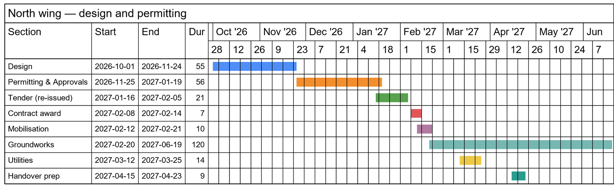
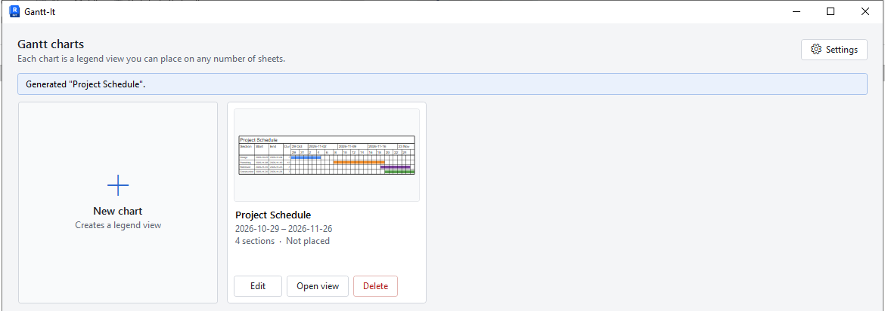
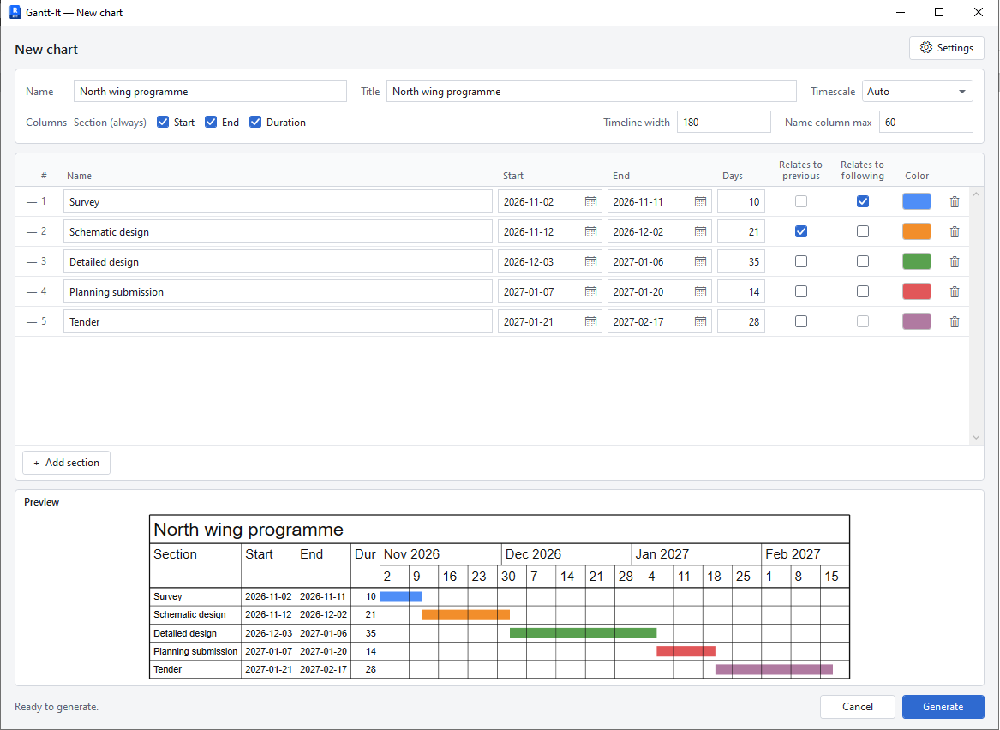
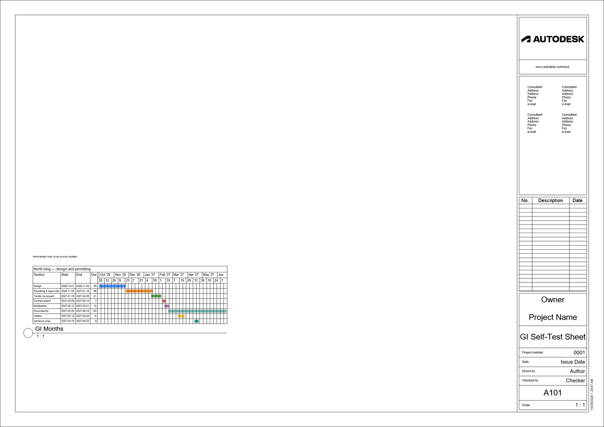

# Gantt-It

**Gantt-It** is a Revit add-in by Designs/OS that draws Gantt charts inside your Revit project, ready to place on your sheets.

**[Project website →](https://jedbjorn.github.io/gantt-it/)**

## What it does

- Draws each chart with your project's own text styles and line styles, and solid colour fills.
- Each chart is a legend view, so you can place it on as many sheets as you like.
- Edit a chart and update it at any time. The sheets it is on update with it.
- Link sections together: change one date and the linked sections move with it.
- Pick bar colours from a palette, by colour code, or straight from the screen.
- Follows Revit's light or dark theme.
- Speaks English, French, Spanish and German.
- Works in Revit 2025, Revit 2026 and Revit 2027.

## Install

1. Download `GanttIt-<version>.msi` from the [latest release](https://github.com/jedbjorn/gantt-it/releases/latest).
2. Close Revit, then run the file.
3. If Windows says "Windows protected your PC", choose **More info**, then **Run anyway**. Windows asks this because Gantt-It is not digitally signed yet. That is expected.
4. Accept the licence and click **Install**. The installer adds Gantt-It to each Revit 2025, 2026 and 2027 it finds on your computer. It installs for you only and needs no administrator rights.
5. Start Revit. Revit asks whether to load Gantt-It, for the same reason: choose **Always Load**.

Gantt-It now appears on the **Add-Ins** tab.

**Upgrade:** close Revit, then run the newer installer. It replaces the old version. Revit asks again whether to load Gantt-It on the next start: choose **Always Load** again.

**Installed another Revit year later?** Close Revit, run the installer again and choose **Repair**. It adds Gantt-It to the Revit you just installed.

**Uninstall:** close Revit, then:

- Windows 11: **Settings › Apps › Installed apps**, find **Gantt-It**, open its **⋯** menu and choose **Uninstall**.
- Windows 10: **Settings › Apps › Apps & features**, select **Gantt-It** and choose **Uninstall**.

Charts you already made stay in your projects as ordinary legend views. Reinstall Gantt-It to edit them again.

Uninstalling leaves one small file behind: `%AppData%\GanttIt\defaults.json`, which holds your default style choices for new projects. Reinstalling picks them up again. To remove it as well, delete the `%AppData%\GanttIt` folder.

## Compatibility

- Every update of Revit 2025, 2026 and 2027, on Windows, from each year's first release on. Older versions of Revit are not supported.
- Revit's journal file shows an "Assembly version conflict in some references" line for Gantt-It (its RevitAPI and RevitAPIUI). That is expected and harmless: Gantt-It is built against the year's first update, and Revit notes that it is running a newer one.

**Raising the minimum update (developers):** Gantt-It compiles against each year's first update (`Nice3point.Revit.Api.*` 2025.0.2, 2026.0.4 and 2027.0.0), so it never calls Revit API that an older update lacks. CI fails if a Revit package is pinned higher. To use newer API on purpose, raise the version in `Directory.Packages.props` and `FLOOR` in `tools/check_revit_api_floor.py` in the same pull request, and update the first line of this section with the new minimum update.

## Quick start

1. Open a project and click **Add-Ins › Gantt-It**.
2. Click **New chart**. The first time in a project, Gantt-It asks you to choose its text and line styles. Pick them and click **Save**.

   

3. Name the chart, then add your sections with **Add section**. Type each name, start and end date, or the number of days. Tick **Relates to previous** to keep a section tied to the one above.

   

4. Click **Generate**. Gantt-It creates a legend view holding your chart.
5. Close Gantt-It. Open a sheet and drag the chart from **Legends** in the Project Browser onto it, as you would any legend.

   

To change the chart later, open Gantt-It again, click **Edit** on its card, make your changes and click **Update**.

## Learn more

The [User guide](docs/USER-GUIDE.md) covers every screen and option, colours, languages, and what to do when something doesn't work.

## More projects

Other open-source projects by the same author:

- **[FAI Browser](https://jedbjorn.github.io/fai-browser/)** — lets a coding agent work in one browser tab you approve, with permission levels, secret redaction and compact page summaries. ([source](https://github.com/jedbjorn/fai-browser))
- **[Subfloor](https://subfloor.designs-os.com)** — a standing team of coding agents for your Git repository, with durable identity, memory, specs and handoffs, run through your coding harness. ([source](https://github.com/jedbjorn/subfloor))
- **[RST](https://jedbjorn.github.io/rst-c/)** — a native Revit add-in for curated ribbon profiles: admins build them, users load them with one click. ([source](https://github.com/jedbjorn/rst-c))
- **[Splash-It](https://jedbjorn.github.io/splash-it/)** — a Revit add-in that colors view tabs by file, so open models and families are easy to tell apart. ([source](https://github.com/jedbjorn/splash-it))
- **[md-converter](https://md-converter.designs-os.com)** — a static web app that renders themed Markdown into styled, shareable HTML. ([source](https://github.com/jedbjorn/md-converter))
- **[Storybench](https://github.com/jedbjorn/storybench)** — a local workspace for developing videos with an AI production agent.
- **[AnJ Cloud](https://jedbjorn.github.io/anj-cloud/)** — household file sync from a gateway you host yourself, with clients for Linux, macOS, Windows and Android. ([source](https://github.com/jedbjorn/anj-cloud))
- **[Pick-It](https://jedbjorn.github.io/pick-it/)** — a Revit add-in that picks any colour on screen, shows its RGB values on the ribbon button and adds it to Revit's custom colours. ([source](https://github.com/jedbjorn/pick-it))

## License

Gantt-It is released under the [MIT License](LICENSE). Copyright (c) 2026 Designs/OS.

---

For developers: building, testing, releases and translations are in [docs/DEVELOPING.md](docs/DEVELOPING.md).
