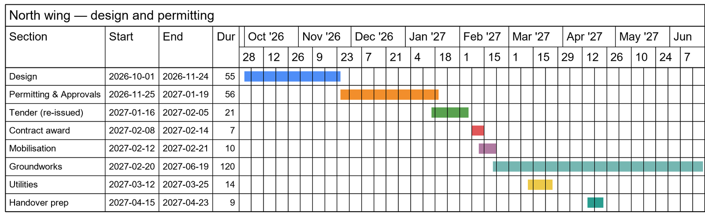
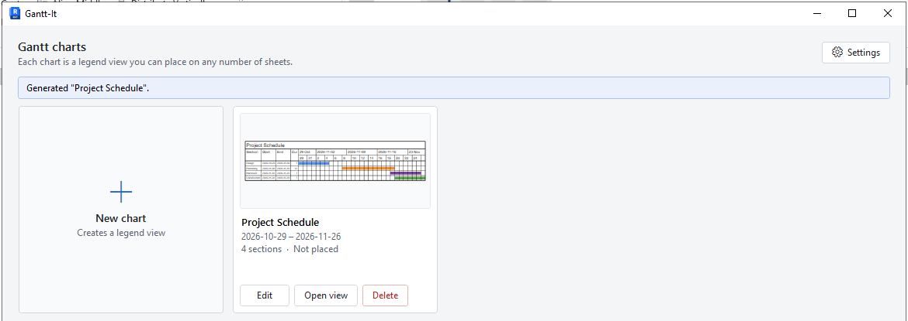
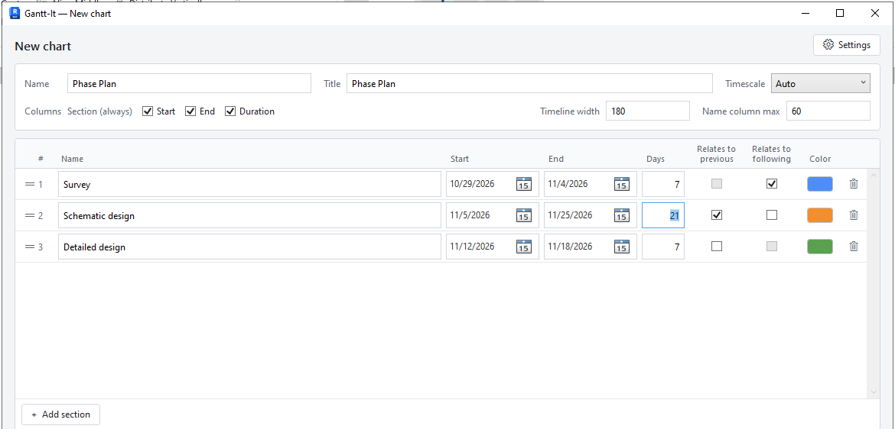
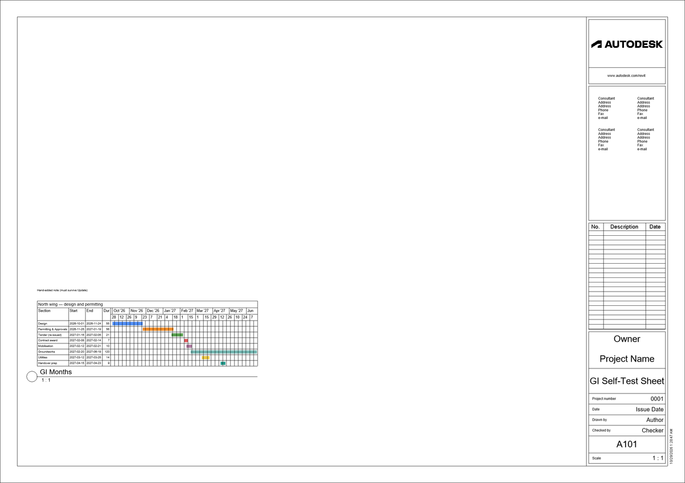

# Gantt-It

**Gantt-It** is a Revit add-in by Designs/OS that draws Gantt charts inside your Revit project, ready to place on your sheets.

## What it does

- Draws each chart with your project's own text styles and line styles, and solid colour fills.
- Each chart is a legend view, so you can place it on as many sheets as you like.
- Edit a chart and update it at any time. The sheets it is on update with it.
- Link sections together: change one date and the linked sections move with it.
- Pick bar colours from a palette, by colour code, or straight from the screen.
- Follows Revit's light or dark theme.
- Speaks English, French, Spanish and German.
- Works in Revit 2026 and Revit 2027.

## Install

1. Download `GanttIt-<version>.msi` from the [latest release](https://github.com/jedbjorn/gantt-it/releases/latest).
2. Close Revit, then run the file. One installer covers Revit 2026 and 2027. It installs for you only and needs no administrator rights.
3. If Windows says "Windows protected your PC", choose **More info**, then **Run anyway**.
4. Start Revit. Revit asks whether to load Gantt-It: choose **Always Load**.

Gantt-It now appears on the **Add-Ins** tab.

Windows and Revit ask these questions because Gantt-It is not digitally signed yet. That is expected.

**Upgrade:** close Revit, then run the newer installer. It replaces the old version. Revit asks again whether to load Gantt-It on the next start: choose **Always Load** again.

**Uninstall:** close Revit, then:

- Windows 11: **Settings › Apps › Installed apps**, find **Gantt-It**, open its **⋯** menu and choose **Uninstall**.
- Windows 10: **Settings › Apps › Apps & features**, select **Gantt-It** and choose **Uninstall**.

Charts you already made stay in your projects as ordinary legend views.

## Quick start

1. Open a project and click **Add-Ins › Gantt-It**.
2. Click **New chart**. The first time in a project, Gantt-It asks you to choose its text and line styles. Pick them and click **Save**.

   

3. Name the chart, then add your sections with **Add section**. Type each name, start and end date, or the number of days. Tick **Relates to previous** to keep a section tied to the one above.

   

4. Click **Generate**. Gantt-It creates a legend view holding your chart.
5. Open a sheet and drag the chart from **Legends** in the Project Browser onto it, as you would any legend.

   

To change the chart later, open Gantt-It again, click **Edit** on its card, make your changes and click **Update**.

## Learn more

The [User guide](docs/USER-GUIDE.md) covers every screen and option, colours, languages, and what to do when something doesn't work.

## License

Gantt-It is released under the [MIT License](LICENSE). Copyright (c) 2026 Designs/OS.

---

For developers: building, testing, releases and translations are in [docs/DEVELOPING.md](docs/DEVELOPING.md).
