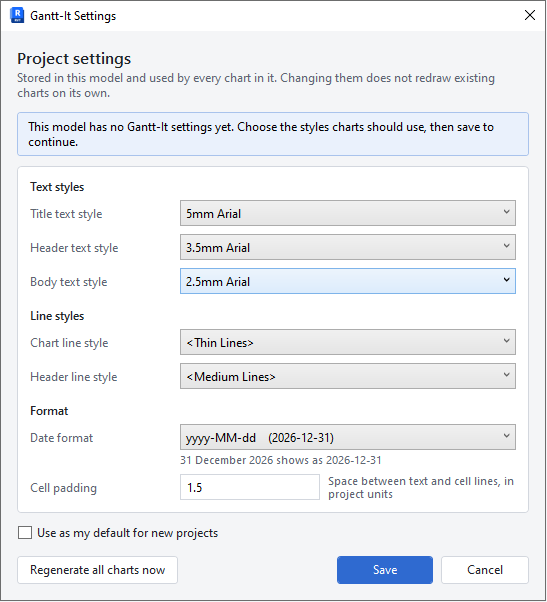
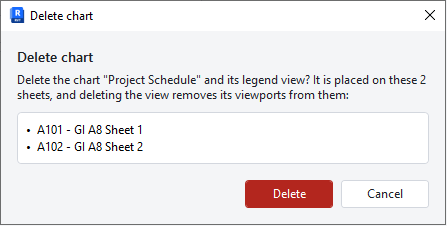
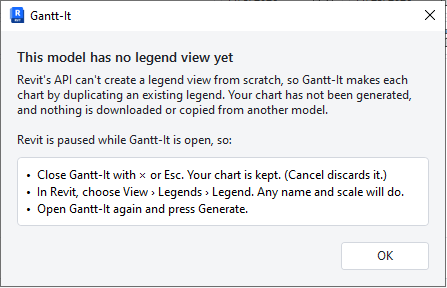

# Gantt-It user guide

Gantt-It draws Gantt charts inside your Revit project. Each chart is a legend view, so you can place it on any number of sheets, and update it whenever the programme changes.

To install Gantt-It, see [Install](../README.md#install) in the README.

## Contents

1. [Opening Gantt-It](#opening-gantt-it)
2. [Settings](#settings)
3. [Making a chart](#making-a-chart)
4. [Colours](#colours)
5. [Generating and placing the chart on sheets](#generating-and-placing-the-chart-on-sheets)
6. [Updating a chart](#updating-a-chart)
7. [Deleting a chart](#deleting-a-chart)
8. [When the project has no legend](#when-the-project-has-no-legend)
9. [Languages and dark mode](#languages-and-dark-mode)
10. [Good to know](#good-to-know)

## Opening Gantt-It

Open a project, go to the **Add-Ins** tab and click **Gantt-It**.

Gantt-It works in projects only. It does not open in a family, because families have no legend views.

The Home screen opens. It shows:

- a **New chart** card, to start a new chart;
- one card for each chart in this project, with a small preview, its first and last dates, how many sections it has, and either "On 2 sheets" (hover to see which sheets) or "Not placed";
- a **Settings** button at the top right.

Each chart card has three buttons:

- **Edit** opens the chart so you can change it.
- **Open view** closes Gantt-It and opens the chart's legend view in Revit.
- **Delete** deletes the chart (see [Deleting a chart](#deleting-a-chart)).

While Gantt-It is open, Revit waits for it. Close Gantt-It (with **×** or Esc) to go back to working in Revit.

## Settings

Settings belong to the project: everyone who opens the project gets the same ones, and every chart in it uses them.

The first time you click **New chart** in a project, Settings opens by itself. Choose the styles and click **Save** to continue. You can open Settings again at any time with the **Settings** button.

<!-- TODO(screenshot): Settings window from a build with languages (PR #13), showing the "Chart language" row under Format. Light theme, metric project, same styles as now. Replace images/settings.png. -->

The styles are the ones already in your project. To get a different look, create or edit a text type or line style in Revit first, then choose it here.

| Setting | What it changes on the chart |
|---|---|
| Title text style | The chart's title. |
| Header text style | The column headings and the dates along the top of the timeline. |
| Body text style | Section names, dates and number of days. |
| Chart line style | The lines between rows and the grid lines of the timeline. |
| Header line style | The lines under the headings and the outer border. |
| Date format | How dates are written, for example `2026-12-31`, `12/31/2026`, `31/12/2026` or `31.12.2026`. Choose **Custom pattern…** to type your own, such as `d MMM yyyy`. A sample shows the result. |
| Cell padding | The space between the text and the lines around it, in your project's units. |
| Chart language | The language of the words drawn on the chart. See [Languages](#languages-and-dark-mode). |

Two more options sit at the bottom:

- **Use as my default for new projects** remembers the style names on your computer. In a new project, Gantt-It picks the styles with the same names.
- **Regenerate all charts now** saves the settings and redraws every chart in the project with them.

Saving settings does not redraw your existing charts on its own. Use **Regenerate all charts now**, or update each chart.

If a chosen style is later deleted from the project, Settings shows it in red. Charts can't be generated or updated until you choose a replacement.

## Making a chart

Click **New chart** on the Home screen. The editor opens with one section to start from.

<!-- TODO(screenshot): Full chart editor from the current build (dates in the chart's date format, e.g. 2026-10-29, and the live preview at the bottom), e.g. the "Phase Plan" chart: Survey, Schematic design, Detailed design, with row 1 "Relates to following" ticked. Light theme. Replace images/editor.png. -->

### Name, title and timescale

- **Name** is the name of the legend view in Revit. It must be different from every other view name in the project.
- **Title** is the text drawn above the chart. It copies the name until you change it. Leave it empty for no title.
- **Timescale** sets the units along the top of the timeline:

| Choice | Top row | Bottom row |
|---|---|---|
| Days | Weeks | Days |
| Weeks | Months | Weeks |
| Months | Years | Months |
| Quarters | Years | Quarters |

**Auto** chooses for you from the length of the whole chart: Days up to 6 weeks, Weeks up to about 9 months, Months up to about 4 years, and Quarters for anything longer.

### Columns and sizes

- **Columns**: the Section column is always shown. Tick **Start**, **End** and **Duration** to show those columns too.
- **Timeline width** is how wide the timeline is on paper, in your project's units.
- **Name column max** is the widest the section name column can get. Longer names wrap onto more lines.

### Sections

Each row is one bar on the chart.

1. Click **+ Add section** to add a row. It starts the day after the last section ends, lasts 7 days, and gets the next colour.
2. Type the section's **Name**.
3. Set its dates in any of three ways:
   - change **Start** to move the section; it keeps its length;
   - change **End** to make it longer or shorter;
   - change **Days** to set its length; the end date follows.

Type dates in the format chosen in Settings, or click the calendar button next to the field.

To delete a section, click the bin at the end of its row.

To reorder sections, drag a row by its handle (the two lines at the left), or move to the handle with Tab and press **Alt+Up** or **Alt+Down**.

### Linking sections

Linking keeps a section tied to its neighbour, so moving one moves the other.

Tick **Relates to following** on a row to link it to the row below. The row below shows **Relates to previous** ticked: it is the same link.

When you tick a link, Gantt-It remembers the current gap between the two sections. It doesn't move anything at that moment. After that:

- change the **Start** of any linked section, and the whole linked group moves by the same number of days, before and after it;
- change the **End** or **Days** of a section, and the linked sections after it move; the ones before it stay put.

Each section keeps its own length when it moves.

Untick a link to free the sections. No dates change.

Moving or deleting a section removes its links, because it no longer sits next to the same sections. A notice at the top of the editor tells you, so you can tick the links again if you need them.

### Preview and problems

The preview at the bottom redraws as you type. It shows what the chart will look like on paper, using your text styles.

If something needs fixing, such as an empty name or an end date before the start date, a list at the bottom of the editor says what. **Generate** stays greyed out until each problem is fixed.

## Colours

Click a section's colour swatch to choose its colour. The colour window offers:

- **Palette**: twelve ready colours. New sections take them in turn.
- **Recent**: colours you chose recently, kept until you close Revit.
- **Hex**: type a colour code such as `#4F8EF7` and click **Apply**.
- **Pick from screen**: the eyedropper button next to **Apply** (see below).
- **More…**: opens the Windows colour window, with the full colour range.

Clicking a colour applies it and closes the window.

<!-- TODO(screenshot): The "Section color" window open from a section's swatch, showing Palette, a filled Recent row, Hex with Apply, the Pick from screen (eyedropper) button and More…. Light theme. Save as images/color-picker.png and insert here. -->

### Pick from screen

Use the eyedropper to match a colour you can already see, such as a colour used on your plans.

1. Before opening Gantt-It, set up Revit so the colour you want is visible on screen. Revit can't be moved or zoomed while Gantt-It is open.
2. Open the colour window and click the eyedropper button.
3. Gantt-It steps out of the way. A magnifier follows the pointer and shows the colour code under it.
4. Move to the colour with the mouse. For fine positioning, use the arrow keys (hold Shift to move faster).
5. Click to pick the colour. Enter or Space also pick it.

Press **Esc** or right-click to cancel without changing anything. Gantt-It comes back either way.

The eyedropper works on every monitor and can pick from any window, not only Revit. It picks the colour exactly as shown on screen, so halftone, transparency and Revit's dark background all change what you get.

<!-- TODO(screenshot): Pick from screen in use over a Revit plan view: the crosshair, the magnifier loupe with its live hex value and the "Click to pick · Esc to cancel" hint. Save as images/pick-from-screen.png and insert here. -->

## Generating and placing the chart on sheets

When the chart looks right, click **Generate**.

Gantt-It creates a legend view with your chart in it and returns to the Home screen, where the new chart has its own card. The legend view is listed under **Legends** in Revit's Project Browser, with the chart's name.

To place it on a sheet:

1. Close Gantt-It.
2. Open the sheet.
3. Drag the chart from **Legends** in the Project Browser onto the sheet.

A legend can go on as many sheets as you like, so you can put the same chart on several sheets. They all show the same chart and all update together.

The chart is drawn at a scale of 1:1, so the sizes you set are its size on paper.

## Updating a chart

1. Open Gantt-It and click **Edit** on the chart's card.
2. Make your changes.
3. Click **Update**.

The chart is redrawn in the same legend view, so it stays on every sheet it was placed on.

Gantt-It redraws the chart from what it has stored. If you changed the chart's own lines, text or bars by hand in Revit, those changes are replaced. Text and lines that you added yourself to the legend view, such as a note beside the chart, are left alone.

To change a chart for good, change it in Gantt-It, not by hand.

**Cancel** leaves the chart as it was.

## Deleting a chart

Click **Delete** on the chart's card, or **Delete chart** in the editor.

Gantt-It asks you to confirm. If the chart is on sheets, it lists them: deleting the chart removes it from those sheets too.

Click **Delete** to delete the chart and its legend view, or **Cancel** to keep it.

## When the project has no legend

Revit doesn't let add-ins create a legend view from nothing. Gantt-It makes each chart by copying an existing legend, so the project needs at least one.

If it has none, clicking **Generate** shows this message:

To fix it:

1. Click **OK**, then close Gantt-It with **×** or Esc. Your chart is kept. (Clicking **Cancel** in the editor throws it away.)
2. In Revit, choose **View › Legends › Legend**. Any name and scale will do.
3. Open Gantt-It again. Your chart is back in the editor, with a note saying it was restored. Click **Generate**.

Your chart is kept until you close Revit.

You only need to do this once per project. After that, Gantt-It can copy any legend, including its own charts.

## Languages and dark mode

### Languages

Gantt-It speaks English, French, Spanish and German.

- **Gantt-It's windows** use Revit's language. In French, Spanish or German Revit they appear in that language; in any other language they appear in English.
- **The chart** uses the **Chart language** chosen in Settings. It sets the words drawn on the chart: column headings, month and quarter names, and the name a new chart starts with.

The chart language belongs to the project. It starts as your Revit language when the project's settings are first saved, and then stays put. So a chart doesn't change language when a colleague with a different Revit language updates it.

To change it, pick another **Chart language** in Settings, then redraw your charts with **Regenerate all charts now**.

<!-- TODO(screenshot): A generated chart (or its preview) with Chart language set to French or German, showing translated column headings and month names (e.g. "janv." / "Jan."). Save as images/chart-french.png (or chart-german.png) and insert here. -->

### Dark mode

Gantt-It follows Revit's theme. If Revit is set to dark (or to follow Windows, and Windows is dark), Gantt-It's windows are dark too.

The chart preview stays white, like paper, so you see the colours as they will print.

<!-- TODO(screenshot): The chart editor in Revit's dark theme, showing the dark window with the white paper preview. Save as images/editor-dark.png and insert here. -->

## Good to know

**Revit asks to load Gantt-It after installing and after each upgrade.** Gantt-It is not digitally signed yet, so Revit asks each time a new version is installed. Choose **Always Load**.

**A chart copied with Revit's Duplicate becomes a plain legend.** It no longer appears in Gantt-It, and Gantt-It never changes it. To make a variant of a chart, click **New chart** and build it in Gantt-It.

**A chart made with a newer version of Gantt-It is read-only.** Its card says so, and **Edit** and **Delete** are off. Install the newer Gantt-It to change it. You can still open it, or delete its legend view by hand in Revit.

**In a shared (workshared) project, someone else may be editing the chart or the settings.** Gantt-It then tells you who, and changes nothing. Ask them to synchronise and give up the element, then try again.

**Gantt-It tidies up its own fill types.** Each bar colour uses a fill type named `Gantt-It Fill #RRGGBB`. When a colour is no longer used anywhere in the project, Gantt-It removes its fill type. A fill type still in use is always kept.

**Every action can be undone.** Generate, Update, Delete, saving Settings and Regenerate all charts are each one step in Revit's Undo list, named after the action (for example "Gantt-It: Update Project Schedule"). Close Gantt-It, then use Revit's **Undo**.

**If something fails, nothing is half-done.** Gantt-It shows what went wrong and leaves the project as it was.
